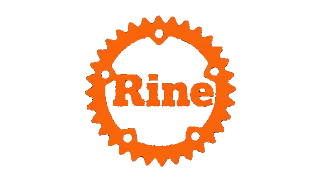

<p align="center">
  
</p>

<h1 align="center">Rine-rs</h1>

<p align="center">
  <b>Rine Is Not an Emulator. Lightweight in-process Win64 compatibility runtime built from scratch in Rust.</b>
</p>

<p align="center">
  
  
  
</p>

<p align="center">
  <a href="#english">English</a> • <a href="#русский">Русский</a>
</p>

---

<a name="english"></a>
## English

> **Notice:** Rine is in an **active experimental stage**. It is a fast, native in-process Win64 compatibility layer for Linux x86_64, actively tested on real Godot, Unity (Mono), and Unity 6 games.

### Overview

**Rine** (*Rine Is Not an Emulator*) is an in-process Win64 execution environment and Windows API translation layer written from scratch in Rust for Linux x86_64 systems under the **GNU General Public License v3.0 (GPL-3.0)**.

Unlike traditional Wine/Proton setups that rely on a mandatory `wineserver` daemon and dozens of auxiliary processes, Rine executes guest Windows PE binaries directly inside a single host process's address space by default. Win32 API calls map straight to native Linux kernel primitives (`futex`, `mmap`, POSIX I/O) and hardware TLS/TEB registers via `arch_prctl`, eliminating daemon IPC overhead. (An optional lightweight `rineserver` module is also available for multi-process descriptor sharing.)

### Key Capabilities

- **In-Process Win64 Runtime & PE32+ Loader:** Parses PE sections, applies base relocations, resolves IAT/delay-load imports, executes TLS callbacks and MSVC `_initterm` initializers, and maps `PEB64`/`TEB64` with `GS Base` via `arch_prctl`.
- **Win64 SEH, Vectored Exceptions & `longjmp` Unwinding:** Native `RtlAddFunctionTable` / `RtlAddGrowableFunctionTable`, `RtlCaptureContext`, `RtlRestoreContext` (including `STATUS_LONGJUMP`), `RtlUnwind`, and `RtlUnwindEx` supporting Mono/Unity JIT and C runtime unwinding.
- **Direct Vulkan Bridge & Standalone DXVK:** Translates `vkCreateWin32SurfaceKHR` to X11/XWayland/SDL2 and loads standalone DXVK (`~/.local/share/rine/dxvk/`) to run Direct3D 9/10/11 over Vulkan without Proton or Wine installed.
- **Native Desktop Launcher (`--gui`) & Overlay (`--overlay`):** Built-in `eframe`/`egui` launcher with Steam library scanning, prefix management, FPS limiter, and desktop integration (`install.sh`).
- **Steamworks Bridge & Matchmaking / Networking:** Hybrid Steamworks layer (`steam_api64.dll` -> native Linux `steamclient.so`) with SteamStub 3.1 unpacking, `SteamAPI_ManualDispatch` (`703` CallResults + raw callbacks), local `ISteamMatchmaking` lobbies, and `ISteamNetworkingSockets` / `ISteamNetworkingUtils` P2P/Relay support.
- **Win32 NLS, Registry & Persistence:** Full Win32 locale/NLS tables (`IsValidLocaleName`, `GetLocaleInfoEx`, `EnumSystemLocalesEx`, `LCIDToLocaleName`, `GetUserPreferredUILanguages`), JSON-backed Windows Registry (`advapi32`) supporting 8-byte `REG_DWORD` `double` values used by Unity `PlayerPrefs.SetFloat`, and Landlock LSM filesystem sandboxing (`RineVfs`).
- **Audio & Input:** Low-latency WASAPI over PipeWire/PulseAudio; full Win32 keyboard, mouse, and raw input message loop (`PeekMessageW`, `GetRawInputData`, `WH_MOUSE_LL`, cursor clipping/warping).

### Benchmarks (NVIDIA GeForce RTX 3060, Linux)

#### 1. *How to Fish* (Unity 6 `6000.4.4f1`, 1920x1080, uncapped FPS, 700 MangoHud samples)

| Metric | Proton Experimental | Rine Win64 Native | Notes |
| :--- | :--- | :--- | :--- |
| **Average FPS** | 129.31 FPS | **136.26 FPS** | **+5.4% higher average FPS** |
| **Peak FPS** | 893.54 FPS | **1,466.23 FPS** | **Higher peak throughput** |
| **Average Frame Time** | 8.59 ms | **8.27 ms** | **Lower average frame time** |
| **1% Low FPS** | **63.81 FPS** | 55.52 FPS | Proton slightly steadier on rare dips |
| **p99 Frame Time** | **15.92 ms** | 18.01 ms | Slightly tighter p99 on Proton |
| **Average GPU Utilization** | 99.4% | **89.9%** | **9.5% lower GPU load** |
| **VRAM Usage** | 3,273 MB | **2,785 MB** | **Saves 488 MB VRAM** |

#### 2. *Cuphead* (Unity Mono, 60-Second Gameplay Profile)

| Metric | Proton Experimental | Rine Win64 Native | Notes |
| :--- | :--- | :--- | :--- |
| **RAM Usage (Average)** | 2,723 MB | **783 MB** | **3.5x less RAM** |
| **Peak RAM Consumption** | 3,310 MB | **818 MB** | **4x lower peak** |
| **Background Processes** | 22 – 24 processes | **1 process** | Single-process runtime |
| **Peak CPU Spike** | 280.5% | **142.0%** | **~2x lower peak spike** |
| **GPU Power Draw** | 57.1 W | **48.3 W** | **~9 W lower power** |

### Compatibility Status

| Title | Engine | Status | Notes |
| :--- | :--- | :--- | :--- |
| **That's Not My Neighbor** | Godot Engine | **Fully Working** | Stable rendering, audio, and input. |
| **Cuphead** | Unity (Mono) | **Fully Working** | Smooth 60 FPS gameplay, WASAPI audio, persistent keybinds. |
| **How to Fish** | Unity 6 (`6000.4.4f1`) | **Working** | SteamStub 3.1, DXVK rendering, mouse/keyboard, localization, `PlayerPrefs` persistence, and Steam lobby/FishySteamworks host startup. |

### Building, Installing & Running

#### Prerequisites
- Rust 1.80+ (with `extern "win64"` support)
- Linux x86_64 with Vulkan 1.3+ driver
- X11 / SDL2 libraries (`libX11`, `libsdl2-dev`)

#### Build & Install
```bash
cargo test --lib -- --test-threads=1
./install.sh
```

#### Run
```bash
rine --gui
rine "/path/to/game.exe"
```

### License

Licensed under the **GNU General Public License v3.0 (GPL-3.0)**. See `LICENSE`.

---

<a name="русский"></a>
## Русский

> **Важно:** Rine находится на **активной экспериментальной стадии**. Это нативный внутрипроцессный слой совместимости Win64 для Linux x86_64, проверяемый на реальных играх на Godot, Unity (Mono) и Unity 6.

### О проекте

**Rine** (*Rine Is Not an Emulator*) — среда выполнения Win64 и слой трансляции Windows API, написанный с нуля на Rust для Linux x86_64 под лицензией **GNU General Public License v3.0 (GPL-3.0)**.

В отличие от Wine/Proton с обязательным фоновым `wineserver` и десятками дочерних процессов, Rine исполняет Windows PE-файлы напрямую в адресном пространстве одного нативного процесса Linux. Вызовы Win32 транслируются прямо на примитивы ядра Linux (`futex`, `mmap`, POSIX I/O) и регистр `GS Base` через `arch_prctl`, убирая лишний IPC-оверхед.

### Ключевые возможности

- **Внутрипроцессный рантайм Win64 и загрузчик PE32+:** парсинг секций, релокации, IAT/delay-load, TLS-колбэки, `_initterm`, инициализация `PEB64`/`TEB64`.
- **Win64 SEH, VEH и `longjmp`:** `RtlAddFunctionTable` / `RtlAddGrowableFunctionTable`, `RtlCaptureContext`, `RtlRestoreContext` (включая `STATUS_LONGJUMP`), `RtlUnwind` и `RtlUnwindEx` для корректной работы JIT Mono/Unity и C-рантайма.
- **Прямой Vulkan Bridge и автономный DXVK:** трансляция `vkCreateWin32SurfaceKHR` на X11/XWayland/SDL2 и встроенный DXVK (`~/.local/share/rine/dxvk/`) для Direct3D 9/10/11 без установленного Proton или Wine.
- **Нативный лаунчер (`--gui`) и оверлей (`--overlay`):** интерфейс на `eframe`/`egui` со сканером библиотеки Steam, управлением префиксами, лимитом FPS и интеграцией в меню приложений Linux (`install.sh`).
- **Гибридный Steamworks Bridge и сеть:** распаковка SteamStub 3.1, мост `steam_api64.dll` -> нативный Linux `steamclient.so`, `SteamAPI_ManualDispatch` (очереди `703` CallResult и сырых колбэков), локальные лобби `ISteamMatchmaking` и `ISteamNetworkingSockets` / `ISteamNetworkingUtils` для P2P и Relay.
- **Локализация Win32 NLS, реестр и песочница:** таблицы локалей (`IsValidLocaleName`, `GetLocaleInfoEx`, `EnumSystemLocalesEx`, `LCIDToLocaleName`, `GetUserPreferredUILanguages`), JSON-реестр (`advapi32`) с поддержкой 8-байтных `REG_DWORD` `double` для `Unity PlayerPrefs.SetFloat`, виртуальная ФС `RineVfs` и изоляция Linux Landlock.
- **Звук и ввод:** WASAPI через PipeWire/PulseAudio с низкой задержкой; полный цикл сообщений клавиатуры, мыши и Raw Input (`PeekMessageW`, `GetRawInputData`, `WH_MOUSE_LL`).

### Результаты бенчмарков (NVIDIA GeForce RTX 3060, Linux)

#### 1. *How to Fish* (Unity 6 `6000.4.4f1`, 1920x1080, без лимита FPS, 700 сэмплов MangoHud)

| Метрика | Proton Experimental | Rine Win64 Native | Примечание |
| :--- | :--- | :--- | :--- |
| **Средний FPS** | 129.31 FPS | **136.26 FPS** | **На +5.4% выше средний FPS** |
| **Пиковый FPS** | 893.54 FPS | **1 466.23 FPS** | **Выше пиковая пропускная способность** |
| **Средний Frame time** | 8.59 мс | **8.27 мс** | **Ниже среднее время кадра** |
| **1% low FPS** | **63.81 FPS** | 55.52 FPS | Proton чуть ровнее на редких просадках |
| **p99 Frame time** | **15.92 мс** | 18.01 мс | Чуть ниже p99 у Proton |
| **Нагрузка GPU** | 99.4% | **89.9%** | **На 9.5% меньше нагрузка на видеокарту** |
| **VRAM** | 3 273 МБ | **2 785 МБ** | **Экономия 488 МБ видеопамяти** |

#### 2. *Cuphead* (Unity Mono, 60-секундный замер геймплея)

| Метрика | Proton Experimental | Rine Win64 Native | Примечание |
| :--- | :--- | :--- | :--- |
| **Средняя RAM** | 2 723 МБ | **783 МБ** | **В 3.5 раза меньше RAM** |
| **Пиковая RAM** | 3 310 МБ | **818 МБ** | **В 4 раза меньше в пике** |
| **Процессы** | 22 – 24 процесса | **1 процесс** | Без фоновых демонов |
| **Пик CPU** | 280.5% | **142.0%** | **В ~2 раза ниже пик** |
| **Потребление GPU** | 57.1 Вт | **48.3 Вт** | **Экономия ~9 Вт** |

### Статус совместимости игр

| Игра | Движок | Статус | Примечания |
| :--- | :--- | :--- | :--- |
| **That's Not My Neighbor** | Godot Engine | **Работает полностью** | Стабильный рендеринг, звук и ввод. |
| **Cuphead** | Unity (Mono) | **Работает полностью** | Стабильные 60 FPS, звук WASAPI, сохранение управления. |
| **How to Fish** | Unity 6 (`6000.4.4f1`) | **Работает** | SteamStub 3.1, DXVK, мышь/клавиатура, локализация, сохранение настроек `PlayerPrefs`, создание Steam-лобби и запуск хоста FishySteamworks. |

### Сборка, установка и запуск

#### Требования
- Rust 1.80+ (с поддержкой `extern "win64"`)
- Linux x86_64, драйвер с поддержкой Vulkan 1.3+
- Библиотеки X11 / SDL2 (`libX11`, `libsdl2-dev`)

#### Сборка и установка
```bash
cargo test --lib -- --test-threads=1
./install.sh
```

#### Запуск
```bash
rine --gui
rine "/путь/к/игре.exe"
```

### Лицензия

Проект распространяется под лицензией **GNU General Public License v3.0 (GPL-3.0)**. Подробности см. в файле `LICENSE`.
